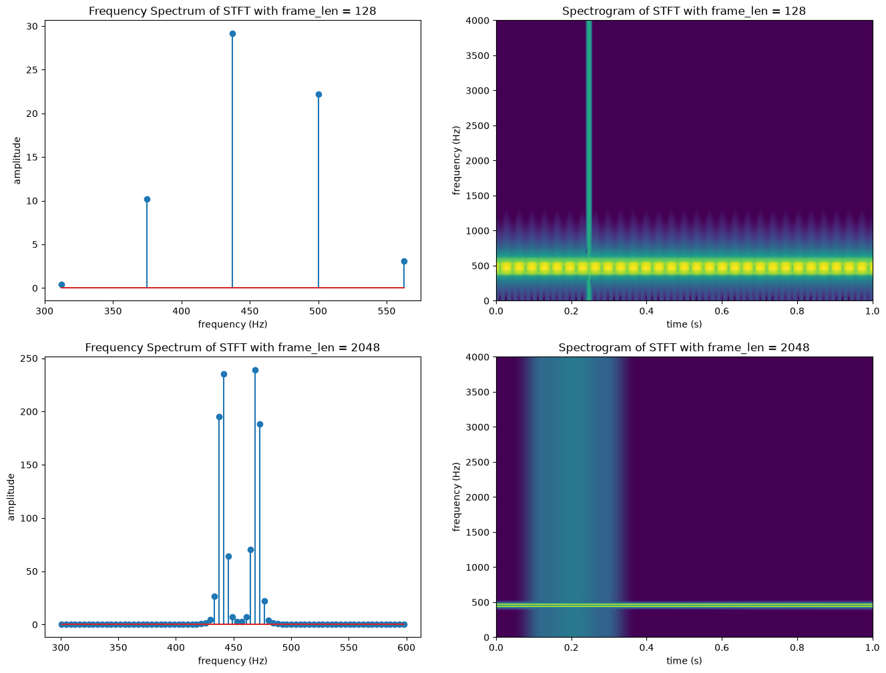

### บันทึกการเรียนรู้ (Learning Journey)

**14 November 2026 (14 พฤศจิกายน 2569)**
* สร้าง folder, GitHub และ Environment สำหรับการพัฒนาและเรียนรู้ Project
> **Link GitHub** : https://github.com/ohm-arthakorn/audio-based_music_recommendation

**15 November 2026 (15 พฤศจิกายน 2569)**
* เรียนเขียนโปรแกรมภาษา Python 101
**Goals** : เรียนเขียนโปรแกรมภาษา Python และสามารถทำโจทย์ E1 - E4 ได้ โดยพยายามให้มีการใช้งาน AI ให้น้อยที่สุด 

**E1 จำนวน sample**: ตั้งตัวแปร `sr = 22050` และ `duration = 2.5 (วินาที)` แล้วคำนวณว่าเสียงยาวเท่านี้มีกี่ sample
✅ ต้องได้ 55125 แล้วลองคิดต่อว่าถ้า duration = 0.01 ได้ทศนิยมหรือไม่ และจำนวน sample ควรเป็นทศนิยมได้หรือเปล่า

**E2 อ็อกเทฟ**: สร้าง list ความถี่ [110, 220, 440, 880] แล้ววน loop พิมพ์ความถี่แต่ละตัวพร้อมอัตราส่วนกับตัวก่อนหน้า
✅ อัตราส่วนต้องเป็น 2 ทุกคู่ (ตัวแรกไม่มีตัวก่อนหน้า ต้องจัดการกรณีนี้เอง)

**E3 ฟังก์ชันแปลงโน้ตเป็นความถี่**: เขียน midi_to_hz(n) จากสูตร

$$f = 440 \times 2^{(n-69)/12}$$

✅ ทดสอบ: 69 → 440.0, 81 → 880.0, 60 → 261.63 (โน้ต C กลาง)
ใบ้: ยกกำลังใน Python ใช้ ** ไม่ใช่ ^ ลองดูว่า 2 ^ 3 ให้ผลเท่าไรและทำไม

**E4 list กับ NumPy (สะพานไปวันที่ 2)**: ทายก่อนรันว่า 2 บรรทัดนี้ให้ผลอะไร
`[1, 2, 3] * 2 np.array([1, 2, 3]) * 2`
✅ ผลจะไม่เหมือนกัน อธิบายให้ได้ว่าทำไม ข้อนี้คือเหตุผลที่ DSP ใช้ NumPy

* เรียนเกี่ยวกับทฤษฎีของ Digital Signal Processing เรียนตามหนังสือ ThinkDSP ของ Allen B. Downey 
**Goals :** สามารถอธิบายเรื่องของสัญญาณ องค์ประกอบของสัญญาณ และสามารถเขียนโปรแกรมเพื่อจำลองสัญญาณได้

---

**16 November 2026**
* เรียนเขียนโปรแกรมเกี่ยวกับ DSP โดยทำโจทย์ทั้ง 4 ข้อ T1-T4 และอาจจะให้ Claude ช่วยสร้างโจทย์สำหรับการเรียนรู้เรื่องนี้เพิ่มเติม 

> **Timbre (แทม-เบอร์) หรือ สีสันของเสียง** : ลักษณะเฉพาะของเสียงที่ทำให้สามารถจำแนกได้ว่าเสียงมาจากแหล่งกำเนิดใด แม้จะเล่นที่โน้ตเดียวกัน ความดังเท่ากัน

> **MFCC (Mel-frequency cepstrum coefficient)** : 
ref : https://dr-pathasu-doung.medium.com/mel-frequency-cepstrum-coefficient-mfcc-b735a349c312

---

**17 November 2026**
* เรียนเขียนโปรแกรมโดยมีการใช้งาน Numpy สำหรับการจัดการเสียง เช่น Slicing, เปรียบเทียบสัญญาณ np.allclose(), การ Normalize, Broadcasting

> อันนี้เป็นความคิดเห็นส่วนตัว : เป็นการเรียนทำ Lab ที่หินมาก คือ Claude มันตรวจแบบเถื่อนในระดับที่เราเองเป็นคนทำยังท้อ มันตรวจละเอียดมาก ความละเอียดของมันเนี่ย ยิบย่อยในระดับงานเนียบอ่ะ ถ้าเราผ่านมาได้นะ บอกเลยว่า มึงเป็นคนที่เนียบฉิบหาย

___

**18 - 19 November 2026**
* วันที่ 18 พฤศจิกายน ระหว่างที่เขียนโปรแกรมก็รู้สึกว่าไม่ค่อยเห็นภาพเท่าไหร่ ไม่รู้ว่าที่เรียนไปจะสามารถเอาไปใช้งานได้จริงไหม บวกกับมีความล้า ความเหนื่อย ไม่แปลกใจเลย นี่สินะ ความเป็นมนุษย์ ตอนแรก ๆ ที่ทำก็คิดอย่างตั้งใจว่ามันคงมีประโยชน์ แต่ว่าพอเจอเรื่องที่คิดว่ามันยาก ก็เริ่มที่จะสั่นคลอนในหัวใจก็ไม่แปลกเลย 
* วันที่ 19 พฤศจิกายน พักผ่อนอย่างเต็มที่และลองพยายามเขียน พยายามอ่าน สิ่งที่ Claude พยายาม Generate มาให้ว่าเรื่องราวมันเป็นยังไง ก็พยายามที่จะเรียนรู้ต่อไป เพราะคิดว่าสักวันนี้จะเป็น Base ของเรา เพื่อพัฒนาตัวเองต่อไป ยังไงซะจะพยายามอ่านทฤษฎีและลองเขียนโปรแกรมด้วยตัวเองดู 

> ส่วนที่เอาไว้ให้ Claude อ่าน : พยายามทำให้โจทย์มันมีความเข้าใจที่ง่ายขึ้นหน่อย ตอนอ่านแล้วไม่ค่อยเข้าใจว่าต้องการอะไร พยายามเขียน Requirement ให้มันเข้าใจง่าย โดยรวมความยากเนี่ยมัน 9/10 เลยล่ะ ลองลดความยาก ท้าทายให้เหลือเพียง 7-8/10 พอ พยายามให้โอมได้เรียนรู้มากที่สุด 

---

**20 November 2026 (20 พฤศจิกายน 2569)**
**Ref :** https://www.youtube.com/watch?v=XQ45IgG6rJ4&list=PL-wATfeyAMNqIee7cH3q1bh4QJFAaeNv0&index=10

**1. แนวคิดของ Fourier Transform** 
Fourier Transform หรือ การแปลงฟูเรียร์ คือ เครื่องมือทางคณิตศาสตร์หนึ่ง เอาไว้สำหรับการแปลงฟังก์ชันหรือสัญญาณ (Signal) จากโดเมนของเวลา (Time domain) ไปเป็นโดเมนของความถี่ (Frequency domain)

> **สมการมาตรฐานของ Fourier Transform** \
> $F(\omega) = \int_{- \infty}^{\infty} f(t) \cdot e^{- i \omega t}\cdot dt$

>**คำถามคือ ทำไมเราจะต้องมีการแปลงจากโดเมนเวลาไปเป็นโดเมนความถี่ด้วยล่ะ ?**

เพราะในโดเมนของความถี่ จะสามารถวิเคราะห์ได้ว่า ฟังก์ชันหรือสัญญาณของเราถูกสร้างมาจากคลื่น Sine หรือ Cosine ความถี่เท่าไหร่ ทำให้ง่ายต่อการวิเคราะห์, สร้าง Filter สำหรับกรองเอาสัญญาณที่เราต้องการ เช่น มีเสียงของกีตาร์ที่ย่านความถี่ $a$ และ เสียงของกลองที่ย่านความถี่ $b$ ถ้าวิเคราะห์ในโดเมนของเวลา สัญญาณเสียงของกีตาร์และกลองจะรวมกันเป็นเพียงสัญญาณเสียงก้อนเดียว ถ้าต้องการได้ยินแค่เสียงของกีตาร์หรือกลอง เราสามารถนำเอาสัญญาณเสียงของกีตาร์และกลองผ่าน Fourier Transform เพื่อแปลงจากโดเมนของเวลาเป็นโดเมนของความถี่ ส่งผลให้ความถี่ของสัญญาณเสียงที่แยกออกจากกันอย่างชัดเจน สามารถใช้ Filter เพื่อกรองความถี่เอาเพียงความถี่ที่เราต้องการและทำการแปลง Inverse Fourier Transform กลับมาเป็นโดเมนของเวลาเพื่อให้ได้สัญญาณเสียงที่ต้องการ

<!-- Prism img -->

> เหมือนกับปริซึมที่หักเหแสงสีขาวออกเป็นแสงทั้ง 7 สี

---
> ระหว่างเดินออกกำลังกาย มีดูคลิปอธิบายประวัติของ Fast Fourier Transform ของช่อง Veritasium และ 9arm พูดถึงเรื่องของความเป็นมาและ Application สำคัญใน Signal Processing
> **Ref:** 
> * คลิปของ Veritasium -> https://youtu.be/nmgFG7PUHfo?si=pFIX--728mGO0SQL
> * คลิปของ 9arm -> https://youtu.be/vvOXAadmd0U?si=rvaUn-iSeluLKdUV

**2. Fast Fourier Transform (FFT):** ช่วงสงครามโลกครั้งที่ 2 หลังจากที่ประเทศสหรัฐอเมริกามีการทิ้งระเบิด Nuclear **Little Boy** และ **Fat Man** ลงประเทศญี่ปุ่นที่ฮิโรชิมาและนางาซากิ ก็เป็นการจบสงครามโลกครั้งที่ 2

    

 ก่อนเข้าสงครามเย็นช่วงที่ประเทศมหาอำนาจ 2 ประเทศ อย่างโซเวียต (ปัจจุบัน คือ รัสเซีย) และประเทศสหรัฐอเมริกากำลังหยั่งเชิงทางการเมืองอยู่ ในขณะนั้นอาวุธสำคัญอย่างระเบิด Nuclear ถือว่าเป็นสิ่งสำหรับการคานอำนาจอย่างมาก ทั้ง 2 ประเทศต่างซุ่มซ้อมและพัฒนาอย่างต่อเนื่อง แต่ก็ต้องผ่อนปรนลงจากสนธิสัญญาระหว่างประเทศหลายฉบับ ในการพัฒนาอาวุธ Nuclear จะต้องมีการทดสอบการระเบิดเพื่อวัดประสิทธิภาพ แต่ในสนธิสัญญาระหว่างประเทศไม่สามารถทำการทดสอบบนพื้นดิน ใต้น้ำและนอกอวกาศได้ หากแต่...ยังมีอีกพื้นที่หนึ่งนั้นคือ **ใต้ดิน** ที่ยังคงสามารถทดสอบแบบลับ ๆ ได้ ซึ่งการทดสอบจะเกิดการสั่นสะเทือนบนพื้นดินเกิดขึ้น โดยจะมีสิ่งที่เรียกว่า **Seismometer** เป็นอุปกรณ์สำหรับการวัดแรงสั่นสะเทือนของบนพื้นผิวโลก 
 

    

ปัญหาจึงเกิดขึ้น **"จะสามารถแยกออกได้อย่างไร ว่าแรงสั่นสะเทีอนที่เกิดขึ้น เกิดจากแผ่นดินไหวที่จากเคลื่อนของแผ่นเปลือกโลกหรือมีการทดสอบอาวุธ Nuclear ใต้พื้นดินเกิดขึ้น"** คำตอบนั้นก็คือการใช้ Fourier Transform ในการแยกแยะว่าความถี่ที่เกิดขึ้นนั้นเกิดจากแผ่นดินไหวหรือมีการทดสอบอาวุธ Nuclear แต่ว่า...ในการคำนวณ Fourier Transform สมัยก่อนมักจะมีรูปแบบการคำนวณด้วยมือควบคู่กับการคำนวณด้วยคอมพิวเตอร์อย่างการใช้ DFT หรือ Discrete Fourier Transform แต่การคำนวณ DFT ด้วยคอมพิวเตอร์ 1 Sample ของข้อมูลจะต้องใช้ Scan ความถี่ทุกแบบที่เป็นไปได้และยิ่งข้อมูลมีจำนวน Sample มากขึ้น ๆ การคำนวณก็จะมี Big O Notation เท่ากับ $N^2$ ซึ่งด้วยจำนวนข้อมูลน้อยยังไม่มีปัญหา แต่ถ้าข้อมูลมีปริมาณมากพลังการคำนวณก็ต้องใช้สูงมาก

    

จนกระทั่งมีนักวิทยาศาสตร์ James W. Cooley และ John W. Tukey ได้คิดค้น Algorithm สำคัญที่ทำให้การคำนวณ DFT เร็วขึ้นจาก Big O Notation $N^2$ เป็น $Nlog_{2}(N)$ โดยกระบวนการคำนวณจะอธิบายเป็นแนวคิดสั้น ๆ คือ สัญญาณ Sine และ Cosine มีคุณสมบัติความสมมาตรกันทำให้บางครั้งในการคำนวณเราสามารถคำนวณเก็บค่าเอาไว้โดยไม่ต้องการคำนวณใหม่ได้ เช่น $sin(\frac{9\pi}{2})=sin(\frac{\pi}{2})$ ซึ่งทำให้ไม่ต้องมีการคำนวณใหม่ โดยในการคำนวณ DFT จะมีรูปแบบการคำนวณจากสมการ $X_{k}=\sum_{n=0}^{N-1}x[n]e^{-j\frac{2\pi nk}{N}}$ ซึ่งในเทอมของ $e^{-j\frac{2\pi nk}{N}}$ หนังสือบางเล่มเราจะเรียกว่า Twiddle Factor ซึ่งเป็นส่วนที่ไม่ต้องมีการคำนวณใหม่

___

**22 November 2026 (22 พฤศจิกายน 2569)**
หัวข้อที่เรียนวันนี้ คือ **Cosine Similarity (ความคล้ายคลึงแบบโคไซน์)** เป็นค่าที่เอาไว้ใช้สำหรับการวัดว่า **"vector 2 ตัว ชี้ไปในทิศทางเดียวกันใกล้เคียงมากน้อยเพียงใด"** ความสำคัญของมันคือ ในการทำ project นี้จะมีการแปลงจากข้อมูลสัญญาณเสียงเป็นข้อมูลจากเวกเตอร์ที่คอมพิวเตอร์สามารถคำนวณได้ Cosine Similarity จึงสามารถนำมาใช้เพื่อจัดกลุ่ม จัดประเภทของข้อมูลเสียงได้ 

    

สมการสำคัญของ Cosine Similarity คือ การหามุมระหว่าง vector หรือ Dot Product
$cos(\theta) = \frac{\textbf{A} \cdot \textbf{B}}{|| \textbf{A} || ||\textbf{B}||}$

ระหว่างการทำ Lab วันนี้มี Keyword สำคัญคือ เรื่องของ **Windowing** และ **Short time Fourier Transform** โดย Lab สองคำนี้คือ การทำเรื่องของ Cosine Similarity ระหว่าง คลื่น Sine ที่มีความถี่เท่ากับ 440 และ 445 Hz โดยมีการกำหนดระยะเวลาของการทำ Cosine Similarity ที่แตกต่างกัน คือ 1 และ 0.05 วินาที ในระยะเวลาที่สั้นมาก ๆ Cosine Similarity กลับไม่สามารถจำแนกความแตกต่างระหว่างคลื่น Sine 440 กับ 445 ได้

___

**23 November 2026 (23 พฤศจิกายน 2569)**
หัวข้อที่ทำแล็ปวันนี้ เรื่อง Fourier Transform โดยจะเน้นที่ Discrete Fourier Transform หรือ DFT \
Fourier Transform เป็นเทคนิคทางคณิตศาสตร์อย่างหนึ่งที่คิดค้นโดย Jean-Baptiste Joseph Fourier โดยสมมติฐานของ Fourier บอกว่า "ฟังก์ชันหรือรูปทรงของคลื่นใด ๆ ก็ตาม ไม่ว่าซับซ้อนหรือหักมุมขนาดไหน ก็ล้วนสามารถสร้างขึ้นได้ด้วยคลื่นไซน์และโคไซน์ที่ความถี่ต่าง ๆ มาบวกรวมกันได้" 

    

และด้วยแนวคิดนั้นกลับกลายเป็นหัวใจสำคัญของวิศวกรรมสมัยใหม่ เช่น Signal Processing, Heat Transfer หรือสัญญาณหรือคลื่นใด ๆ ก็สามารถนำเอาความรู้ที่ Fourier ได้คิดค้นมาใช้ได้

สมการของ Discrete Fourier Transform : $X(k) = \sum_{n=1}^{N}x(n)e^{-j\omega_{k}n}$
เมื่อ $k=0,1,...,N$

___ q

**24 November 2026 (24 พฤศจิกายน 2569)**
หัวข้อของการทำแล็ปในวันนี้ คือ STFT (Short Time Fourier Transform) ซึ่งเป็นวิธีการวิเคราะห์แบบหนึ่งที่มีการใช้งาน Fourier Transform เหมือนกัน ความแตกต่างจะอยู่ที่ในการใช้ไม่ว่าจะเป็น DFT/FFT สิ่งที่จะเป็น output ออกมาคือ Frequency Spectrum หรือ องค์ประกอบความถี่ของสัญญาณ ว่าสัญญาณที่เราสนใจสามารถสังเคราะห์จากคลื่นไซน์หรือคลื่นโคไซน์ความถี่ที่แตกต่างกัน แต่บางครั้งเวลาก็สามารถเป็นส่วนหนึ่งของการวิเคราะห์สัญญาณของเราได้เช่นกัน \
STFT หรือ Short Time Fourier Transform จึงมีข้อได้เปรียบที่เหนือกว่า DFT/FFT ในส่วนนี้ 
> หลักการของการทำ STFT คือ การแบ่งสัญญาณที่เราสนใจออกเป็นก้อน ๆ ซึ่งเราจะเรียกมันว่า **Frame** จากนั้นเราก็จะทำการ FFT ตัว Frame นั้นเพื่อให้ได้ Frequency Spectrum ออกมา เราสามารถทำแบบนี้ไปเรื่อย ๆ กับทั้งสัญญาณได้ ก็จะได้เป็น Frequency Spectrum ที่เป็นก้อน ๆ มาต่อ ๆ แล้วถ้าเราทำการใส่สีให้กับขนาดของความถี่นั้น ๆ และทำการพล็อตระหว่างเวลาและความถี่ เราก็จะได้สิ่งที่เรียกว่า **Spectrogram** ออกมาซึ่งเป็นสิ่งสำคัญในการวิเคราะห์สัญญาณที่มีเรื่องของเวลาเข้ามาเกี่ยวข้อง

    

สมการที่สำคัญของการทำ STFT
> $X[m,k]=\sum_{n=0}^{N-1}x[n+mH]\cdot w[k]\cdot e^{\frac{-j2\pi kn}{N}}$

โดยที่ตัวแปร $m$ คือ Index ของ Frame, $H$ คือ Hop Size และ $w[k]$ คือ Windowing Function

Windowing Function มีหน้าที่เอาไว้สำหรับการบีบสัญญาณของเราเพื่อป้องกัน **Spectral Leakage**

---

**25 November 2026 (25 พฤศจิกายน 2569)**
วันนี้จะต้องมีการทำเรื่องของ STFT ต่อ โดยวันนี้ค่อนข้างมีข้อสงสัยเรื่องของ `rfft`, `rfftfreq` ว่ามันคืออะไรมาก ๆ ทั้งที่ความจริง เมื่อวานก็มีการเขียนไปแต่ว่าก็ไม่ได้สงสัย วันนี้จะลองเขียนตามความเข้าใจของตัวเองดู

1. `rfftfreq(N, 1/sr)` คือ ป้ายกำกับของแต่ละ Column ในการทำ STFT
> ทบทวนการทำ STFT S[m, k] จะมีการ return ออกมาเป็น array ที่มี 2 มิติประกอบด้วย 
> 1. m คือ ลำดับของ frame  
> 2. k คือ ลำดับของ frequency bins (ช่องสัญญาณ)
> ค่าในแต่ละช่องคือ magnitude ของสัญญาณหลังจากการทำ FFT   

แต่จากตรงนี้แหละ ! การ return ค่าของการทำ FFT มันไม่ได้กำหนดช่วงของความถี่ของสัญญาณด้วย ซึ่งทำให้ยากต่อการตรวจสอบว่าที่ magnitude ขนาดเท่านี้ มันคือ ความถี่เท่าไหร่ด้วย

เราจึงต้องทำเหมือนกับป้ายกำกับว่าทั้งความยาวนี่อ่ะ มันอยู่ที่ระยะความถี่ไหนบ้าง เหมือนการเอาท่อนไม้ยาว ๆ ที่มีตำหนิมาทาบพร้อมกับไม้บรรทัดเพื่อบอกว่า ตำหนินี่อยู่ห่างจากปลายสุดฝั่งหนึ่งเท่าไหร่ 

โดยในฟังก์ชันจะต้องใส่ค่า parameter 2 ตัวคือ N จำนวน Sample ในหนึ่ง frames, 1/sr หรือ คาบของ Sampling Rate
ซึ่งระยะของ Frequency Bins จะสามารถคำนวณได้จากสูตร ระยะห่างของ $bins = \frac{sr}{N}$

แต่ว่ามีข้อดีก็ต้องมีข้อเสีย ในการทำ STFT มี trade-off บางอย่างซ่อนอยู่ นั่นคือ **time-frequency trade-off** หมายความว่า เมื่อเฟรมยาวนานขึ้นจะแยกความถี่ได้ละเอียดมากขึ้นแต่จะไม่สามารถบอกได้ว่าเกิดขึ้นตอนไหน ในทางกลับกัน เฟรมสั้นลงจะแยกความถี่ได้ละเอียดลดลงแต่จะสามารถบอกได้ว่าเกิดขึ้นตอนไหน
หรือสามารถเขียนเป็นสมการได้เป็น
ความละเอียดเชิงเวลา ($\Delta t$): $\Delta t = \frac{N}{f_s}$ และความละเอียดเชิงความถี่ ($\Delta f = \frac{f_s}{N}$) เมื่อ $f_s$ คือ Sampling Rate

> **ขนาดของหน้าต่าง (Window size)** มีความหมายเหมือนกับ **ขนาดของเฟรม (Frame size)** 

    

ในการทดลองได้สร้างสัญญาณ Sine ที่มีความถี่เท่ากับ 440 แอมพลิจูดขนาด 0.5 และความถี่เท่ากับ 470 แอมพลิจูดขนาด 0.5 จากนั้นทำการเปรียบเทียบระหว่างขนาด frame 128 samples และ 2048 samples

โดยจะมีการกำหนดขนาด hop เท่ากับ $\frac{frame size}{4}$ และมีการปัดขึ้น ซึ่ง bins แต่ละ `frame_len` จะมีขนาดเท่ากับ 62.5 Hz และ 3.91 Hz ตามลำดับ

สังเกตว่า ยิ่ง bins มีขนาดเล็กหมายความว่า ความละเอียดของการวิเคราะห์ความถี่มากขึ้น (เพราะการแบ่งช่องสัญญาณมันถี่มาก แสดงว่าละเอียดมาก) 

> **สูตรระยะของ Bins (Frequency Bin Spacing)**
> $\Delta f = \frac{S_{r}}{N} = \frac{1}{T}$

สังเกตที่ frequency spectram ของรูปด้านบน มีการใช้งาน `frame_len` เท่ากับ 128 หมายความว่า มีความละเอียดของการวิเคราะห์ความถี่น้อย ในขณะที่ความละเอียดของเวลาสูง spectrogram ข้าง ๆ สามารถบอกได้ว่าเกิดความถี่ประมาณนี้ที่เวลาไหนบ้าง จึงสังเกตเห็นคลิกที่เกิดขึ้นที่เวลา 0.25 s 

ในทางกลับกันกราฟ frequency spectrum ของรูปด้านล่างมีการใช้งาน `frame_len` เท่ากับ 2048 หมายความว่า มีความละเอียดของการวิเคราะห์ความถี่สูง สามารถบอกได้ว่าความถี่ที่เกิดเกิดจากอะไรได้บ้าง แต่พอมาสังเกตที่กราฟของเวลาไม่สามารถวิเคราะห์ได้ละเอียดเท่ากับด้านบน

**26 November 2026 (26 พฤศจิกายน 2569)**

> **Recap สิ่งที่เรียนเมื่อวาน**
> 1. ST4 ฝึกเขียน STFT เอง โดยมีการเขียนฟังก์ชัน stft() และมีการ call function `frame_signal` ที่เคยได้มีการเขียนไว้ และเปรียบเทียบ stft() กับ librosa.stft() ว่าผลลัพธ์ตรงกันไหม (จากการทำแล็ปเมื่อวานพบว่าผลลัพธ์ตรงกัน)
> 2. ST5 มีการเปรียบเทียบระหว่าง Linear scale และ Log scale (dB) โดยผลลัพธ์ของการทำแล็ปเมื่อวานคือ ค่าบางความถี่ที่มี magnitude ไม่ได้สูงใน linear scale ทำให้สังเกตได้ยากใน spectrogram แต่เมื่อนำข้อมูลเดียวกันมา plot บน Log scale ความถี่ที่มี magnitude ที่ไม่ได้สูงก็สามารถสังเกตเห็นได้
> 3. ST6 ทดลองเรื่องของ Trade-off ระหว่าง time, frequency จะสามารถสรุปผลได้คือ เมื่อเฟรมยาวนานขึ้นจะแยกความถี่ได้ละเอียดมากขึ้นแต่จะไม่สามารถบอกได้ว่าเกิดขึ้นตอนไหน ในทางกลับกัน เฟรมสั้นลงจะแยกความถี่ได้ละเอียดลดลงแต่จะสามารถบอกได้ว่าเกิดขึ้นตอนไหน

---

**27 November 2026 (27 พฤศจิกายน 2569)**
เมื่อวาน วันที่ 26 พฤศจิกายน 2569 เป็นวันที่นอนน้อยเลยทำให้ไม่สามารถ progress การเรียนรู้เรื่องของ DSP ได้ แต่ว่า...วันนี้พร้อมแล้วล่ะ !

#### **Recap**
เมื่อวานติดปัญหาเรื่องของการทำความเข้าใจ Concept ของ Convolution และการเขียนโปรแกรมเพื่อคำนวณ Convolution 

การเขียนโปรแกรมเพื่อคำนวณ Convolution ติดปัญหาเรื่องของการวน For Loop ว่าจะต้องมีลักษณะการวนแบบไหน
> **Solution : แบ่งการทำงานออกเป็น Step ย่อย ๆ ก่อน**
> 1. รู้ขนาดของ output array ก่อนโดยใช้สมการคำนวณหา output array size = len(x)+len(h)-1 แล้วทำการ assign ให้ค่าใน array เป็น 0 ด้วยการใช้งาน `np.zeros()`
> 2. จากสมการการทำ Convolution : $y[n]=\sum_{k=0}^{M-1} h[k] \cdot x[n-k]$ คือ กระบวนการนำ Kernel มาเลื่อนทาบ คูณและบวกรวมกับสัญญาณ input ทีละตำแหน่ง เพื่อสร้างเป็นสัญญาณใหม่ $y[n]$ ที่ผ่านการกรองแล้ว 
>
>**Algorithm ลำดับการทำงาน**
>นำตำแหน่ง (n) ของ input signal array สร้างเป็น loop การทำงานแรก จากนั้นนำตำแหน่ง (k) ของ filters เป็น loop การทำงานที่สอง โดยในลูปการทำงานที่สองจะนำตำแหน่งของ input signal array ลบกับ ตำแหน่งของ filters : i = n - k 
> สร้างเงื่อนไขการตรวจสอบว่า i น้อยกว่า 0 (i<0) หรือ i มันมากกว่าตำแหน่งของ input signal array ไหม (i>len(x)-1) ? ถ้าเป็นจริงจะให้ข้ามไปทำงานที่ iteration ถัดไปทันที ถ้าไม่เป็นจริงจะทำงานตามคำสั่งด้านล่างคือการคูณและบวกสัญญาณระหว่าง $h[k]$ กับ $x[n-k]$ ณ ตำแหน่ง n ใน output signal array ($y[n]$) 

#### **ทบทวน**
Convolution ในภาษาไทยมีชื่อเท่ ๆ อย่าง "สังวัตนาการ" ซึ่งประเด็นหลัก ๆ ของการเรียนรู้วันนี้ คิดว่าเป็นเรื่องของการทำ Filters และกลไกการทำงานของ Convolution
Convolution คือ การดำเนิการทางคณิตศาสตร์ที่นำฟังก์ชันสองชุดมาผสมรวมกัน เพื่อคำนวณว่า "สัญญาณอินพุต (x[n]) จะมีการเปลี่ยนแปลงรูปร่างไปอย่างไร เมื่อไหลผ่านระบบหรือตัวกรอง (h[n])" 

